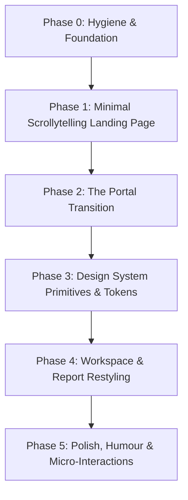

# Comprehensive Frontend & System UI Audit

**Project:** BeyondPDF — AI-Powered SEBI BRSR Disclosure Analysis & Greenwashing Detection  
**Audit Type:** Read-Only UI & Architecture Assessment  
**Auditor:** Antigravity Agentic Pair Programmer  
**Date:** October 2026  
**Target Overhaul:** Phase 1 (Minimal Scrollytelling Landing Page, Light Mode, GSAP ScrollTrigger) & Phase 2 ("Enter the System" Transition, Premium Workspace, Custom Cursor, React Bits, Polished Micro-Interactions)

---

## 1. PROJECT OVERVIEW

### 1.1 Product Purpose & Capabilities
**BeyondPDF** is an automated auditing, scoring, and benchmarking platform for SEBI (Securities and Exchange Board of India) Business Responsibility and Sustainability Reporting (BRSR) filings. Built as an evidence-backed capstone research system, its primary mission is to detect corporate ESG greenwashing and measure disclosure transparency without the inaccuracies of legacy PDF/OCR scrapers.

The system ingests machine-readable, officially tagged SEBI XBRL filings (`.xml`, `.xbrl`) and runs them through a multi-engine audit pipeline:
1. **Truth Auditor (`src/analysis/truth_auditor.py`)**: Checks corporate narrative prose against the company's own officially filed multi-year numeric disclosures to flag **Claim-Evidence Contradictions**, detects **Silent Removals** (disclosures present in prior periods that were quietly omitted in subsequent filings), and flags **Vague/Unsubstantiated Commitments** lacking quantitative KPIs.
2. **Composite Transparency Scoring (`src/analysis/scoring/transparency_score.py`)**: Computes a 0–100 score weighted across Completeness (40%), Specificity (30%), Clarity (20%), and SDG Alignment (10%).
3. **Internal Mathematical Consistency Checks (`src/analysis/audit_checks/consistency.py`)**: Discovers gender and employee category breakdowns and verifies arithmetic integrity across filed tables.
4. **Assurance Profiling (`src/analysis/audit_checks/assurance.py`)**: Measures third-party audit coverage (Reasonable vs. Limited vs. Unassured).
5. **Sector Benchmarking (`src/analysis/scoring/`)**: Benchmarks companies against peer groups using precomputed distributions (`data/analysis/sector_benchmarks.csv`), reporting percentiles, sector means/medians, and leader/laggard designations.
6. **Peer-to-Peer Multi-Company Comparison**: Side-by-side comparative analysis of up to 5 companies across transparency scores, multi-year GHG/energy/water trends, and audit red flags.
7. **Ad-hoc Filing Ingestion & Auditing**: A drag-and-drop workspace where users upload XBRL filings for real-time parsing, consistency checks, scoring, and report generation.

### 1.2 Repository Topology: Monorepo vs. Single App
The repository is a **hybrid polyglot codebase** (Python backend/data science + Next.js frontend) structured as follows:
- **Root**: Hosts the Python virtual environments (`.venv`), core backend packages (`src/`), data stores (`data/`), experimental scripts (`scripts/`), test suites (`tests/`), research paper documentation (`paper/`), and project docs (`docs/`).
- **Frontend Subdirectory (`frontend/`)**: Hosts an independent Next.js App Router application bootstrapped with `create-next-app`.
- **Note on Root Debt**: Root contains a remnant `package.json` and `package-lock.json` listing 4 dependencies (`clsx`, `framer-motion`, `lucide-react`, `tailwind-merge`) with no scripts or workspace configuration. This is an accidental artifact from an earlier command executed in the root directory rather than in `frontend/`.

```
brsr-ai/
├── .env                              # Root environment config (GEMINI_API_KEY)
├── README.md                         # Project overview and pipeline instructions
├── requirements.txt                  # Python dependencies (FastAPI, SQLAlchemy, PyTorch, transformers, etc.)
├── sample_brsr.xml                   # Sample SEBI BRSR XBRL filing
├── package.json                      # [DEBT] Accidental 9-line root package file
├── package-lock.json                 # [DEBT] Accidental root package lock
├── data/
│   ├── brsr.db                       # Active SQLite database (622 MB, 1,164 companies, 1,172 filings)
│   ├── filings.csv                   # Master filing metadata
│   ├── analysis/                     # Precomputed benchmark CSVs (sector_benchmarks.csv, transparency_scores.csv)
│   └── xbrl_uploads/                 # Target folder for user-uploaded filings
├── docs/                             # Engineering and research documentation (00 to 07, limitations)
├── frontend/                         # Next.js App Router Application
│   ├── next.config.ts                # Next.js configuration
│   ├── package.json                  # Frontend manifest and scripts
│   ├── postcss.config.mjs            # PostCSS configuration with @tailwindcss/postcss
│   ├── tsconfig.json                 # TypeScript compiler configuration
│   ├── public/                       # Static SVGs (file, globe, next, vercel, window)
│   └── src/
│       ├── app/                      # App router pages, layouts, loading skeletons
│       ├── components/               # Domain sections, search, grids, and UI primitives
│       └── lib/                      # Typed API client and styling utilities
├── paper/                            # Capstone research paper LaTeX and text sources
├── scripts/                          # Numbered research scripts (01_ingestion to 07_reporting)
├── src/                              # Importable Python backend logic
│   ├── analysis/                     # Truth auditor, scoring, consistency, vagueness, greenwashing
│   ├── api/                          # FastAPI app (main.py, routes.py, schemas.py, converters.py)
│   ├── db/                           # SQLAlchemy models and session handling
│   └── ingestion/                    # XBRL parser, facts extraction, and PDF extractor
└── tests/                            # Pytest test suite for backend analysis and ingest
```

### 1.3 Package Manager, Node Version & Scripts
- **Node.js Runtime**: `v22.14.0` (Active on user system)
- **Package Manager**: `npm` `10.9.2` (Lockfile: `frontend/package-lock.json`, Lockfile Version 3)
- **Frontend Scripts (`frontend/package.json:5-9`)**:
  - `npm run dev`: Runs `next dev` (Next.js development server on `http://localhost:3000`)
  - `npm run build`: Runs `next build` (Next.js production build)
  - `npm run start`: Runs `next start` (Next.js production server)
  - **Critical Gap**: There are **no `lint` or `test` scripts** defined in `frontend/package.json`. No ESLint, Prettier, Jest, or Vitest configurations exist in `frontend/`.

---

## 2. FRONTEND STACK

### 2.1 Framework, Router & TypeScript
- **Framework**: Next.js `16.3.1` (`frontend/package.json:15`)
- **React Engine**: React `19.2.8` and React-DOM `19.2.8` (`frontend/package.json:17-18`)
- **Router**: Next.js App Router (`frontend/src/app/`)
- **Language**: TypeScript `^5` (`frontend/package.json:28`), configured in `frontend/tsconfig.json` with target `ES2017`, `moduleResolution: "bundler"`, and path alias `"@/*": ["./src/*"]`.

### 2.2 Styling Approach & Theme Configuration
The frontend uses **Tailwind CSS v4** (`tailwindcss: ^4`, `@tailwindcss/postcss: ^4`).
There is **no `tailwind.config.js` or `tailwind.config.ts`**. Tailwind v4 relies entirely on CSS-first configuration via `@import "tailwindcss";` and `@theme inline` in `frontend/src/app/globals.css`.

#### Key Theme Configuration (`frontend/src/app/globals.css:1-28`):
```css
@import "tailwindcss";

:root {
  --background: #f8fafc;
  --foreground: #0f172a;
  --muted: #f1f5f9;
  --muted-foreground: #64748b;
  --accent: #10b981;
  --accent-foreground: #ffffff;
  --border: #e2e8f0;
  --card: #ffffff;
}

@theme inline {
  --color-background: var(--background);
  --color-foreground: var(--foreground);
  --color-muted: var(--muted);
  --color-muted-foreground: var(--muted-foreground);
  --color-accent: var(--accent);
  --color-accent-foreground: var(--accent-foreground);
  --color-border: var(--border);
  --color-card: var(--card);
  
  --font-sans: var(--font-geist-sans);
  --font-mono: var(--font-geist-mono);
  --font-serif: var(--font-playfair);
}
```

### 2.3 Existing Animation Libraries
1. **Framer Motion (`framer-motion: ^13.1.0`)**: Heavily integrated across 10 files:
   - `frontend/src/app/template.tsx`: Default page-level enter transition (`opacity: 0, y: 10` -> `opacity: 1, y: 0`).
   - `frontend/src/components/ui/card.tsx`: Base `Card` is a `motion.div`.
   - `frontend/src/components/ui/animated-number.tsx`: Number ticker using `useMotionValue` and `useSpring`.
   - `frontend/src/components/HomeClient.tsx`: Interactive radial spotlight glow (`useMotionValue`, `useSpring`, `useMotionTemplate`) and staggered entry variants.
   - `frontend/src/components/CompaniesGrid.tsx`: Layout-animated company cards (`AnimatePresence`, staggered items).
   - `frontend/src/app/compare/page.tsx`: Circular SVG dash-offset animation and company badge entry.
   - `frontend/src/components/report/TransparencyScoreSection.tsx`: SVG circular progress stroke animation.
   - `frontend/src/components/report/SectorBenchmarkSection.tsx`: Score indicator sliding animation.
   - `frontend/src/components/report/TruthAuditorSection.tsx`: Collapsible accordion animation.
   - `frontend/src/app/upload/page.tsx`: Cycling loading status text transitions.
2. **OGL (`ogl: ^1.0.11`)**: Used exclusively inside `frontend/src/components/ui/GradientWaves.tsx` (a WebGL raymarching shader container). Currently dead code (unimported).
3. **HTML5 Canvas 2D**: Manual `requestAnimationFrame` loop in `frontend/src/components/ui/data-flow-background.tsx`. Currently dead code (unimported).
4. **GSAP / Lenis / Lottie**: None currently installed.

### 2.4 State Management & Data-Fetching Patterns
- **Global State**: **None**. No Redux, Zustand, Recoil, or React Context providers exist in the application.
- **Server State / Caching**: **None**. No React Query (TanStack Query) or SWR.
- **Data-Fetching Pattern**:
  - Server Components (`frontend/src/app/page.tsx`, `frontend/src/app/companies/page.tsx`, `frontend/src/app/company/[name]/page.tsx`) call methods on the handwritten API singleton `api` in `frontend/src/lib/api.ts` with `{ cache: "no-store" }`.
  - Client Components (`ComparePage`, `UploadPage`, `CompanySearch`) invoke `api` inside React `useEffect` or event handlers, setting local `useState`.
- **Unused Dependency**: `axios: ^1.19.0` is present in `package.json` but **never imported or used anywhere** in the codebase. All network requests use native `fetch`.

### 2.5 UI Libraries, Fonts, Charts & Conflict Matrix
- **Icons**: `lucide-react: ^1.31.0` (used throughout).
- **Fonts**: `next/font/google` (`frontend/src/app/layout.tsx:2-20`):
  - `Geist` (`--font-geist-sans`) -> mapped to `--font-sans`
  - `Geist_Mono` (`--font-geist-mono`) -> mapped to `--font-mono`
  - `Playfair_Display` (`--font-playfair`) -> mapped to `--font-serif`
- **Charts**: `recharts: ^3.10.1` (`frontend/src/components/ui/sparkline.tsx`), dynamically imported with `{ ssr: false }` inside `TrendsSection.tsx:7`. Custom SVG markup is used for circular score dials and 1D plots.

#### Stack Conflict Warnings for Planned Overhaul:
| Library / Feature | Potential Conflict | Severity | Mitigation Strategy |
|---|---|---|---|
| **GSAP + ScrollTrigger** | React 19 Strict Mode double-invokes effects; Next.js App Router dynamic page unmounting leaves orphaned ScrollTrigger instances. | **HIGH** | Use `@gsap/react` (`useGSAP()`) hook with explicit scoping; kill and refresh ScrollTrigger on route change. |
| **Lenis Smooth Scroll** | Conflicts with Recharts SVG pointer event coordinates and custom cursor tracking if window scroll offset is hijacked. | **MEDIUM** | Sync Lenis ticker with GSAP (`lenis.on('scroll', ScrollTrigger.update)`); set `pointer-events: none` on cursor canvas/layer. |
| **React Bits Components** | Most React Bits snippets expect Tailwind v3 `tailwind.config.js` or Three.js dependencies (`three`, `@types/three`). | **MEDIUM** | Convert Tailwind v3 utility classes to Tailwind v4 `@theme` tokens; copy TS versions; install `three` only if WebGL components require it (project currently only has `ogl`). |
| **Custom Cursor** | Nested interactive elements with `cursor-pointer`, input focus states, and drag-and-drop zones will desync or fight native cursor. | **MEDIUM** | Hide native cursor on `body` (`cursor: none`), add touch device media query bypass (`@media (hover: none)`), wrap in high z-index (`z-[9999]`) layer with `pointer-events: none`. |
| **`template.tsx` Transitions** | Global Framer Motion route fade (`template.tsx`) will conflict with GSAP cinematic "Enter the system" timeline. | **HIGH** | Remove or bypass `template.tsx` during phase transitions so GSAP timeline has exclusive layout control. |

### 2.6 Theme & Dark Mode Logic
- **Current State**: There is **no dark mode switch, theme provider, or `.dark` CSS rule**.
- **The Core Problem**: The root theme is locked to light mode (`--background: #f8fafc`, `--foreground: #0f172a`), but the component markup is **riddled with dark-mode utility classes** copied from a previous dark design:
  - `bg-white/5`, `border-white/10`, `hover:bg-white/10` (used in cards, pills, buttons, skeletons)
  - `bg-black/40`, `bg-black/30`, `bg-black/20` (used in inputs and containers)
  - `text-rose-300`, `text-orange-400`, `text-emerald-400` (low-contrast pastel tints designed for dark backgrounds)
- **Remediation**: All pseudo-dark Tailwind opacity classes (`white/*`, `black/*`) must be eradicated and mapped to clean light-mode semantic tokens (`var(--card)`, `var(--border)`, `var(--muted)`).

---

## 3. ROUTES AND PAGES

### 3.1 Route Inventory Table

| Route Path | File Path | Purpose | Auth Required | Layouts / Wrappers | Main Components Used | API Endpoints Invoked |
|---|---|---|---|---|---|---|
| `/` | `frontend/src/app/page.tsx` | Home / Workspace landing page with quick search, capabilities overview, and entry cards | **No** | `layout.tsx`, `template.tsx` | `HomeClient`, `CompanySearch`, `Link` | `GET /companies` |
| `/companies` | `frontend/src/app/companies/page.tsx` | Full catalog of monitored companies with client pagination | **No** | `layout.tsx`, `template.tsx` | `CompaniesGrid`, `Card` | `GET /companies` |
| `/companies` (Loading) | `frontend/src/app/companies/loading.tsx` | Skeleton fallback during company list retrieval | **No** | `layout.tsx` | `Card` (pulsing skeletons) | None |
| `/company/[name]` | `frontend/src/app/company/[name]/page.tsx` | Complete multi-section disclosure and greenwashing analysis report | **No** | `layout.tsx`, `template.tsx` | `TrendsSection`, `ConsistencySection`, `TransparencyScoreSection`, `SectorBenchmarkSection`, `TruthAuditorSection`, `AssuranceSection`, `GreenwashingSection`, `SilentRemovalsSection` | `GET /companies/{name}/report`, `GET /companies/{name}/transparency-score`, `GET /companies/{name}/sector-benchmark`, `GET /companies/{name}/truth-audit` |
| `/company/[name]` (Loading) | `frontend/src/app/company/[name]/loading.tsx` | Skeleton fallback for the report page | **No** | `layout.tsx` | `Card` (pulsing skeletons) | None |
| `/compare` | `frontend/src/app/compare/page.tsx` | Interactive side-by-side comparison matrix for 2 to 5 companies | **No** | `layout.tsx`, `template.tsx` | `Card`, `Search`, `Plus`, `X`, `AnimatePresence` | `GET /companies`, `GET /companies/compare?names=...` |
| `/upload` | `frontend/src/app/upload/page.tsx` | Drag-and-drop XBRL filing uploader with real-time analysis & inline report | **No** | `layout.tsx`, `template.tsx` | `UploadCloud`, `FileType`, `CheckCircle2`, `AlertCircle`, Report sections | `POST /companies/upload-and-analyze`, `GET /companies/{name}/transparency-score`, `GET /companies/{name}/sector-benchmark`, `GET /companies/{name}/truth-audit` |
| `/methodology` | `frontend/src/app/methodology/` | [UNFINISHED] Placeholder folder — completely empty | **No** | N/A | None | None |

### 3.2 Page Classification
- **Current Landing / Home Page**: `frontend/src/app/page.tsx` rendering `frontend/src/components/HomeClient.tsx`. Currently serves as both landing hero and search workspace.
- **Auth Pages**: **None**. Zero authentication or protected route logic exists in the entire stack.
- **Main App Shell**: `frontend/src/app/layout.tsx` providing Google fonts, sticky header navbar with logo and links, and standard footer. `frontend/src/app/template.tsx` provides route-level entrance animation.
- **Hidden / Unfinished / Broken Pages**:
  - `frontend/src/app/methodology/`: Directory exists on disk but contains **zero files**. In `frontend/src/app/layout.tsx:61-65`, the "Methodology" navigation link points to `/` instead of `/methodology`.
  - `frontend/src/app/upload/page.tsx:272`: Uses `<BarChart3>` inside the sector benchmark fallback but **never imports `BarChart3` from `lucide-react`**, which causes a runtime crash if a benchmark is missing.
  - Skeletons in `companies/loading.tsx` and `company/[name]/loading.tsx` use `bg-white/10` and `bg-white/5` — rendering them 100% invisible against the `#f8fafc` background.

---

## 4. FEATURE INVENTORY

This inventory catalogs every functional capability currently active in the system that must be preserved during the redesign:

### Feature 1: Company Search & Autocomplete
- **Location**: Home (`/`), Compare (`/compare`)
- **Components**: `frontend/src/components/CompanySearch.tsx`, `frontend/src/app/compare/page.tsx`
- **What it does**: Client-side fuzzy search across company names and CIN (Corporate Identity Numbers) with a keyboard/mouse dropdown selector.
- **States**:
  - *Default*: Pill input with search icon.
  - *Focused*: Border glow, active ring.
  - *Results Found*: Elevated dropdown with highlighted CINs and directional arrows (`CompanySearch.tsx:39-60`).
  - *No Matches*: "No companies found matching '{query}'" empty banner (`CompanySearch.tsx:62-65`).

### Feature 2: Monitored Companies Catalog & Slicing
- **Location**: `/companies`
- **Components**: `frontend/src/components/CompaniesGrid.tsx`, `frontend/src/app/companies/page.tsx`
- **What it does**: Displays the 1,164 companies in an interactive 3-column card grid. Shows Company Name, CIN, and NIC sector code. Implements local "Load More" pagination (+12 cards per click).
- **States**:
  - *Loading*: 9-card pulsing skeleton (`companies/loading.tsx`).
  - *Success*: Staggered card grid with hover scaling, green border highlight, and corner arrow reveal (`CompaniesGrid.tsx:40-64`).
  - *Empty*: "No companies found. Make sure the backend is running" (`companies/page.tsx:22-24`).

### Feature 3: Multi-Year Quantitative ESG Trends
- **Location**: Report Page (`/company/[name]`), Upload Page (`/upload`)
- **Components**: `frontend/src/components/report/TrendsSection.tsx`, `frontend/src/components/ui/sparkline.tsx`
- **What it does**: Renders 6 core ESG indicators (Scope 1, Scope 2, Scope 3 GHG emissions, Total Waste, Water Withdrawal, Total Energy). Displays latest reported value, year-over-year percentage delta with arrow indicators (emerald for reduction, amber for increase), and a Recharts SVG sparkline.
- **States**:
  - *Success*: Grid of metric cards with formatted numbers and mini sparkline graphs.
  - *Empty*: Section returns `null` if trends array is empty (`TrendsSection.tsx:16`).

### Feature 4: Internal Consistency Arithmetic Checks
- **Location**: Report Page (`/company/[name]`), Upload Page (`/upload`)
- **Components**: `frontend/src/components/report/ConsistencySection.tsx`
- **What it does**: Validates filed numbers against internal mathematical integrity (e.g. employee gender splits summing to 100%). Displays summary counters (Total Checks, Passed, Failed, Skipped). If discrepancies exist, expands individual cards showing concept name, failure rationale, and context.
- **States**:
  - *Success (Clean)*: 4 metric stat cards; failure list remains unrendered.
  - *Discrepancies Found*: Highlighted amber failure cards with detailed audit context (`ConsistencySection.tsx:54-74`).

### Feature 5: Composite Transparency Scoring
- **Location**: Report Page (`/company/[name]`), Upload Page (`/upload`)
- **Components**: `frontend/src/components/report/TransparencyScoreSection.tsx`
- **What it does**: Displays the 0–100 overall transparency score in an animated circular SVG gauge (color-coded: emerald >= 65, amber 40–64, rose < 40). Breaks down the 4 sub-factors (Completeness 40%, Specificity 30%, Clarity 20%, SDG Alignment 10%) with progress bars and weights.
- **States**:
  - *Success*: Animated SVG dial with count-up ticker and 4 weighted progress cards.
  - *Missing*: Skips rendering if API returns `null`.

### Feature 6: Sector Peer Benchmarking
- **Location**: Report Page (`/company/[name]`), Upload Page (`/upload`)
- **Components**: `frontend/src/components/report/SectorBenchmarkSection.tsx`
- **What it does**: Evaluates company performance against sector peers from `sector_benchmarks.csv`. Shows sector name, leader/laggard badge, percentile rank (e.g. 84th percentile), peer group sample size, reliability disclaimer if n < 10, and an interactive 1D distribution plot showing company score relative to Sector Median and Mean.
- **States**:
  - *Success*: Benchmark details with animated marker on 1D plot.
  - *Unavailable*: Glass panel fallback stating "Sector benchmark data is not yet available for this company's peer group" (`company/[name]/page.tsx:80-91`).

### Feature 7: Truth Auditor (Unified Greenwashing & Narrative Verification)
- **Location**: Report Page (`/company/[name]`), Upload Page (`/upload`)
- **Components**: `frontend/src/components/report/TruthAuditorSection.tsx`
- **What it does**: Core greenwashing verification interface. Displays 3 metric cards:
  1. *Claim-Evidence Contradictions* (clickable accordion).
  2. *Silent Removals* (clickable accordion).
  3. *Vague/Unsubstantiated Segments*.
  - When Contradictions are expanded: Displays full quotes of narrative corporate claims ("We decreased emissions..."), matched against actual filed XBRL data realities (Previous Year vs. Latest Year value and % change), with severity badges (`notable` vs `worth_reviewing`) and assurance status.
  - When Silent Removals are expanded: Lists metrics that were disclosed in prior filings but disappeared in the latest filing, showing prior value and rationale.
- **States**:
  - *High Confidence Contradiction*: Prominent amber warning banner at top of section (`TruthAuditorSection.tsx:39-49`).
  - *Collapsible Accordions*: Smooth Framer Motion height expansion on card click.

### Feature 8: Third-Party Assurance Coverage
- **Location**: Report Page (`/company/[name]`), Upload Page (`/upload`)
- **Components**: `frontend/src/components/report/AssuranceSection.tsx`
- **What it does**: Analyzes third-party audit verification across ESG disclosures. Renders percentage of disclosures under Reasonable Assurance, a segmented multi-color progress bar (Reasonable vs. Limited vs. Unassured counts), and tags listing low/unassured disclosure areas.
- **States**:
  - *Success*: Large percentage stat callout + segmented distribution bar.
  - *No Disclosures*: Glass panel fallback stating "No assurance-related disclosures found in this filing" (`AssuranceSection.tsx:12-26`).

### Feature 9: Peer-to-Peer Company Comparison
- **Location**: `/compare`
- **Components**: `frontend/src/app/compare/page.tsx`
- **What it does**: Lets users select 2 to 5 companies via tag picker, then fetches and renders a multi-column comparative matrix:
  - Header row with company names and CINs.
  - Circular Transparency Score dials with mini sub-component stacked bars and star badge on best performer.
  - YoY Trend Comparison across 6 core metrics with star badge highlighting top performer.
  - Truth Auditor Flag count comparison (Contradictions vs. Silent Removals) with shield badge for zero-defect filings.
- **States**:
  - *Selection*: Tag pill list with remove (`X`) buttons.
  - *In-Flight*: "Comparing..." disabled state on button.
  - *Error*: Rose error text if fewer than 2 companies or network fails (`compare/page.tsx:188`).
  - *Company Not Found in DB*: Card placeholder showing "Not found in database" (`compare/page.tsx:213-219`).

### Feature 10: XBRL Filing Upload & Real-Time Ingestion
- **Location**: `/upload`
- **Components**: `frontend/src/app/upload/page.tsx`
- **What it does**: Full file-handling interface for `.xml` and `.xbrl` filings. Supports drag-and-drop or manual file browsing. On upload, triggers backend ingestion, fact processing, and full audit pipeline, then auto-scrolls down to reveal the complete report inline.
- **States**:
  - *Idle / DragOver*: Dashed dropzone with emerald highlight on hover/drag (`upload/page.tsx:160-165`).
  - *File Selected*: File name, file size in KB, "Clear" and "Analyze Filing" buttons.
  - *Analyzing / Ingestion*: Pulsing spinner with cycling step messages ("Parsing XBRL facts...", "Auditing narrative consistency...", "Detecting silent removals...").
  - *Success*: Success banner ("Filing processed successfully") followed by full inline report.
  - *Error*: Rose banner with API error detail (`upload/page.tsx:207-215`).

---

## 5. COMPONENT AUDIT

### 5.1 Component Directory Structure
```
frontend/src/components/
├── CompaniesGrid.tsx                 # Paginated card grid for /companies
├── CompanySearch.tsx                 # Search input with autocomplete dropdown
├── HomeClient.tsx                    # Client controller for / (spotlight glow, quick links)
├── report/                           # Domain-specific report sections
│   ├── AssuranceSection.tsx          # Reasonable vs Limited assurance coverage
│   ├── ConsistencySection.tsx        # Math/table check summary & discrepancy logs
│   ├── GreenwashingSection.tsx       # [REDUNDANT] Standalone contradiction cards
│   ├── SectorBenchmarkSection.tsx    # Percentile rank & 1D distribution plot
│   ├── SilentRemovalsSection.tsx      # [REDUNDANT] Standalone silent removals
│   ├── TransparencyScoreSection.tsx  # Circular score gauge & 4 weighted sub-factors
│   ├── TrendsSection.tsx             # 6 ESG KPI cards with sparklines
│   └── TruthAuditorSection.tsx       # Unified verification accordion
└── ui/                               # Primitives & graphic components
    ├── GradientWaves.css             # Container styles for OGL canvas
    ├── GradientWaves.tsx             # [UNUSED] OGL WebGL raymarching shader
    ├── animated-number.tsx           # Framer motion count-up ticker
    ├── badge.tsx                     # Pill badge with 7 semantic variants
    ├── card.tsx                      # Base glassmorphic card wrapping motion.div
    ├── data-flow-background.tsx      # [UNUSED] 2D canvas mouse-reactive data stream
    └── sparkline.tsx                 # Recharts line chart wrapper
```

### 5.2 Reusable Primitives & Props API

#### 1. `Card` (`frontend/src/components/ui/card.tsx`)
- **Props**: `HTMLMotionProps<"div">` (all standard HTML div attributes + Framer Motion animation props + `className`, `children`, `ref`).
- **Implementation**: Wraps `motion.div` with `.glass-panel rounded-3xl p-6 transition-all duration-300`.
- **Note**: Hardcodes `rounded-3xl` and `p-6`, which forces consumers to override padding manually when smaller cards are needed.

#### 2. `Badge` (`frontend/src/components/ui/badge.tsx`)
- **Props**: `React.HTMLAttributes<HTMLSpanElement>` & `variant?: "default" | "success" | "warning" | "danger" | "info" | "notable" | "worth_reviewing"`.
- **Implementation**: Inline span with `rounded-full border px-2.5 py-0.5 text-xs font-semibold`.

#### 3. `AnimatedNumber` (`frontend/src/components/ui/animated-number.tsx`)
- **Props**: `{ value: number; className?: string; formatter?: (v: number) => string; delay?: number }`.
- **Implementation**: Uses `useSpring(useMotionValue(0))` and `useInView` to tick up numbers once visible in viewport.

#### 4. `Sparkline` (`frontend/src/components/ui/sparkline.tsx`)
- **Props**: `{ data: any[]; dataKey?: string; color?: string; height?: number }`.
- **Implementation**: Wraps Recharts `<ResponsiveContainer>` and `<LineChart>` with hidden Y-axis and smooth bezier lines.

#### 5. `GradientWaves` (`frontend/src/components/ui/GradientWaves.tsx`)
- **Props**: 20 customizable shader uniforms (`horizonColor`, `waveColor`, `crestColor`, `speed`, `amplitude`, `swell`, `turbulence`, `grain`, etc.).
- **Implementation**: Raw WebGL 2.0 raymarched plasma shader via OGL. **Currently unreferenced in any page**.

#### 6. `DataFlowBackground` (`frontend/src/components/ui/data-flow-background.tsx`)
- **Props**: None.
- **Implementation**: Canvas 2D grid and particle streams that repel away from cursor position. **Currently unreferenced in any page**.

### 5.3 Glaring Component Inconsistencies & Duplications
1. **Critical Code Duplication in Report Views**:
   - `TruthAuditorSection.tsx` (lines 127–195) contains the exact same JSX and logic for rendering Claim-Evidence Contradictions as `GreenwashingSection.tsx` (lines 33–103).
   - `TruthAuditorSection.tsx` (lines 209–233) contains the exact same JSX and logic for rendering Silent Removals as `SilentRemovalsSection.tsx` (lines 16–37).
   - In both `frontend/src/app/company/[name]/page.tsx` and `frontend/src/app/upload/page.tsx`, **all three components are rendered simultaneously**. This causes contradictions and silent removals to be displayed **twice** on the same screen (once inside the Truth Auditor accordion, and again directly below as standalone sections).
2. **Missing Essential Primitives**:
   - **No `Button` primitive**: Every button is an ad-hoc inline `<button>` tag with contradictory styling (some use `rounded-full`, some `rounded-xl`, some `bg-accent`, others `bg-white/10`).
   - **No `Input` primitive**: Search boxes in `CompanySearch.tsx` and `compare/page.tsx` use disparate inline styles, different padding, and different focus rings.
   - **No `Modal` / `Dialog` primitive**: Any future modal requirements have zero existing foundations.
   - **No `Skeleton` primitive**: Skeletons in `loading.tsx` are hardcoded ad-hoc divs with invisible styling.
3. **Runtime Bug in Upload Fallback**:
   - In `frontend/src/app/upload/page.tsx:272`, `<BarChart3 className="w-8 h-8 text-muted-foreground" />` is used in the Sector Benchmark fallback, but `BarChart3` was omitted from the `lucide-react` import statement on line 5. If benchmark data is missing, this crashes the page.

### 5.4 Reusability Rating Table

| Component | Path | Verdict | Rationale & Recommendation |
|---|---|---|---|
| `Card` | `src/components/ui/card.tsx` | **Restyle in place** | Solid `motion.div` foundation. Decouple hardcoded `p-6 rounded-3xl` into default variants. |
| `Badge` | `src/components/ui/badge.tsx` | **Restyle in place** | Clean semantic API. Update color tokens to fit the minimal light aesthetic. |
| `AnimatedNumber` | `src/components/ui/animated-number.tsx` | **Reuse as is** | Excellent Framer Motion spring ticker. No changes needed. |
| `Sparkline` | `src/components/ui/sparkline.tsx` | **Restyle in place** | Performs well. Ensure SSR safe import is preserved; refine stroke colors. |
| `GradientWaves` | `src/components/ui/GradientWaves.tsx` | **Rebuild / Relocate** | Heavy WebGL shader. Candidate for landing page backdrop or phase 2 transition canvas if scoped properly. |
| `DataFlowBackground` | `src/components/ui/data-flow-background.tsx` | **Delete** | Unused, basic 2D canvas stream. Does not fit the "extreme minimal aesthetic" mandate. |
| `CompanySearch` | `src/components/CompanySearch.tsx` | **Restyle in place** | Good fuzzy filtering. Needs custom cursor interaction hooks and ARIA accessibility roles. |
| `CompaniesGrid` | `src/components/CompaniesGrid.tsx` | **Restyle in place** | Sound layout animation. Strip out `bg-white/5` dark tokens and replace with crisp light borders. |
| `HomeClient` | `src/components/HomeClient.tsx` | **Rebuild** | Current home page mixes landing page copy with workspace search. Will be replaced by Phase 1 Scrollytelling page. |
| `TruthAuditorSection` | `src/components/report/TruthAuditorSection.tsx` | **Restyle & Consolidate** | Excellent domain capability. Restyle to extreme light minimal; absorb standalone greenwashing/removal sections. |
| `GreenwashingSection` | `src/components/report/GreenwashingSection.tsx` | **Delete** | 100% duplicate of `TruthAuditorSection` contradictions view. |
| `SilentRemovalsSection` | `src/components/report/SilentRemovalsSection.tsx` | **Delete** | 100% duplicate of `TruthAuditorSection` silent removals view. |
| `TransparencyScoreSection` | `src/components/report/TransparencyScoreSection.tsx` | **Restyle in place** | SVG dial works well. Needs cleaner minimal typography and light-mode stroke accents. |
| `SectorBenchmarkSection` | `src/components/report/SectorBenchmarkSection.tsx` | **Restyle in place** | 1D percentile rank plot is effective. Fix contrasting track lines (`bg-white/10` -> light gray). |
| `AssuranceSection` | `src/components/report/AssuranceSection.tsx` | **Restyle in place** | Strong visual summary. Update stacked bar contrast colors. |
| `TrendsSection` | `src/components/report/TrendsSection.tsx` | **Restyle in place** | Clear 6-card metric overview. Keep sparkline integration. |

---

## 6. DESIGN TOKENS AND GLOBAL STYLES

### 6.1 Token System
- **Color Variables (`frontend/src/app/globals.css:3-12`)**:
  - `--background`: `#f8fafc` (Slate 50)
  - `--foreground`: `#0f172a` (Slate 900)
  - `--muted`: `#f1f5f9` (Slate 100)
  - `--muted-foreground`: `#64748b` (Slate 500)
  - `--accent`: `#10b981` (Emerald 500)
  - `--accent-foreground`: `#ffffff`
  - `--border`: `#e2e8f0` (Slate 200)
  - `--card`: `#ffffff`
- **Typography Tokens (`globals.css:24-26`)**:
  - Sans: `Geist` (clean technical sans-serif)
  - Mono: `Geist Mono` (used for CIN numbers, financial metrics, and code tags)
  - Serif: `Playfair Display` (used in headers: `font-serif italic`)
- **Spacing, Radius & Shadows**:
  - Spacing relies on standard Tailwind utility scale (`p-6`, `p-8`, `gap-6`, `space-y-12`).
  - Radius is consistently exaggerated (`rounded-2xl`, `rounded-3xl`, `rounded-full`).
  - Shadows use `.glass-panel` (`box-shadow: 0 4px 6px -1px rgba(0,0,0,0.05), 0 2px 4px -1px rgba(0,0,0,0.03)`).

### 6.2 Global CSS Rules & Resets
- `globals.css:29-34`: Body defaults to `background: var(--background); color: var(--foreground); font-family: var(--font-sans); -webkit-font-smoothing: antialiased;`.
- `globals.css:45-48`: Headings `h1-h6` force `letter-spacing: -0.04em; font-weight: 500;`.
- `globals.css:51-54`: Global selection color (`::selection`) forced to Emerald accent (`#10b981`).
- `globals.css:57-73`: Custom slim scrollbar (6px width, transparent track, soft thumb).

### 6.3 Z-Index Architecture & Overflow Rules
- **Z-Index Layering**:
  - `z-50`: Top navigation header (`layout.tsx:38`), search dropdown wrapper (`CompanySearch.tsx:19`).
  - `z-20`: Autocomplete dropdown in compare page (`compare/page.tsx:159`).
  - `z-10`: Interactive cards on home page (`HomeClient.tsx:67`), sticky column headers in comparison matrix (`compare/page.tsx:205`), score center dial numbers (`TransparencyScoreSection.tsx:88`).
  - `z-0`: Background patterns, radial gradients, benchmark guideline markers.
- **Overflow Behavior**:
  - `html, body`: Set to `h-full` and `min-h-full flex flex-col`. There is **no global `overflow: hidden` on body or html**, which is favorable for standard ScrollTrigger workflows.
  - Page-level containers (`HomeClient.tsx:52`, `compare/page.tsx:108`) enforce `overflow-hidden` or `overflow-x-hidden`.
  - Comparison matrix (`compare/page.tsx:194`) uses `overflow-x-auto` with custom thin scrollbars.
  - Accordion dropdowns in `TruthAuditorSection.tsx` enforce `overflow-hidden` during Framer Motion height interpolation.
- **Scroll Hijacking Caution**: Smooth scroll engines like Lenis must target `window` / `document.documentElement` directly. Any intermediate wrapper with `overflow-y: scroll` or `height: 100vh` will break Lenis and ScrollTrigger synchronization.

### 6.4 Cursor Styling
- **Current Cursor Declarations**:
  - `cursor-pointer` is declared explicitly on cards (`CompaniesGrid.tsx:43`), links, clear buttons, and footer spans.
  - `cursor-default` on capability pill badges (`HomeClient.tsx:89`).
  - `cursor-not-allowed` on disabled comparison buttons (`compare/page.tsx:181`).
  - Drag-and-drop zone (`upload/page.tsx:163`) sets `cursor-pointer`.
- **Custom Cursor Impact**: None of the components set `cursor: none` or custom SVGs. When mounting a custom cursor, all elements must retain their accessibility focus states while the root custom cursor subscribes to pointermove events with `pointer-events: none`.

---

## 7. LAYOUT AND NAVIGATION

### 7.1 App Shell Structure
- **Root Layout (`frontend/src/app/layout.tsx`)**:
  - **Header (`layout.tsx:38-75`)**: Sticky glassmorphic topbar (`h-16`, `sticky top-0 z-50 glass-panel`). Contains the brand mark ("BeyondPDF" in Playfair italic with a pulsing green dot) and 4 navigation links:
    - `Companies` (`/companies`)
    - `Compare` (`/compare`)
    - `Methodology` (incorrectly points to `/`)
    - `Analyze Filing` (pill button pointing to `/upload`)
  - **Main Slot (`layout.tsx:76`)**: `<main className="flex-1 flex flex-col">{children}</main>`.
  - **Footer (`layout.tsx:77-94`)**: Bordered bottom banner with capstone copyright notice and non-functional "Privacy" / "Terms" cursor-pointer spans.
- **Responsiveness & Breakpoints**:
  - Uses standard Tailwind breakpoints (`md: 768px`, `lg: 1024px`, `xl: 1280px`).
  - **Shortcoming**: Navigation links in the top header have no mobile hamburger menu or drawer. On mobile screens (<640px), the 4 nav links cram against the logo or wrap awkwardly.

### 7.2 Page Transitions & The "Enter System" Hook
- **Current Mechanism**: `frontend/src/app/template.tsx` automatically intercepts every route transition, wrapping the children in:
  ```tsx
  <motion.div
    initial={{ opacity: 0, y: 10 }}
    animate={{ opacity: 1, y: 0 }}
    transition={{ ease: "easeInOut", duration: 0.5 }}
    className="flex-1 flex flex-col"
  >
    {children}
  </motion.div>
  ```
- **Where Landing → System "Enter" Should Hook In**:
  - The cleanest architecture is a **Route-Based Transition**:
    - The new minimal scrollytelling landing page occupies `/` (with a dedicated minimal layout or header bypass).
    - At the climax of the landing page scroll, the user reaches the "Enter the System" portal.
    - Triggering "Enter" executes a full-screen unmasking animation (curtain split, camera push, or iris wipe), then routes cleanly to `/companies` or `/workspace`.
    - Alternatively, an App-shell layout controller in `layout.tsx` can check the active pathname: when on `/`, the standard header/footer are hidden; when entering any app route (`/companies`, `/company/*`, `/compare`, `/upload`), the app navigation smoothly animates into place.

---

## 8. BACKEND (ONLY WHAT THE FRONTEND NEEDS)

### 8.1 Backend Stack & Source Location
- **Framework**: Python FastAPI (`uvicorn api.main:app --reload --app-dir src`)
- **Database Engine**: SQLite (`data/brsr.db`, 622 MB, managed via SQLAlchemy ORM in `src/db/`)
- **Source Code**:
  - Routes & Endpoints: `src/api/routes.py` (304 lines)
  - Data Models / Contract: `src/api/schemas.py` (136 lines)
  - Data Converters: `src/api/converters.py`
  - Core Verification: `src/analysis/truth_auditor.py`
  - App Entrypoint & CORS: `src/api/main.py` (CORS configured with `allow_origins=["*"]`)

### 8.2 Complete API Surface Table

| Method | Endpoint Path | Query / Body Parameters | Response Payload Shape | Auth Required | Cache / Performance Characteristics |
|---|---|---|---|---|---|
| `GET` | `/companies` | None | `list[CompanySummary]` (`id`, `cin`, `name`, `nic_code`) | **None** | Fast (~50ms). Returns all 1,164 companies at once in a single JSON array (~90 KB). |
| `GET` | `/companies/{name}/filings` | `name: str` (path) | `list[FilingSummary]` (`id`, `financial_year_start`, `end`, `raw_fact_count`) | **None** | Fast. Returns filing history for company. |
| `GET` | `/companies/{name}/report` | `name: str` (path) | `CompanyFullReport` (Full trends, consistency, assurance, greenwashing, removals) | **None** | Medium (~150-300ms). Executes 5 SQL analysis pipelines across latest filing facts. |
| `GET` | `/companies/{name}/transparency-score` | `name: str` (path) | `TransparencyScoreBreakdown` (completeness, specificity, clarity, SDG, composite) | **None** | Medium (~100-200ms). Calculates 4-factor weighted score. |
| `GET` | `/companies/{name}/truth-audit` | `name: str` (path) | `TruthAuditorSummary` (narratives checked, contradictions, removals, vague segments) | **None** | Medium (~150-300ms). Runs full truth auditor engine. |
| `GET` | `/companies/{name}/sector-benchmark` | `name: str` (path) | `SectorBenchmarkInfo` (sector, mean, median, percentile, leader/laggard) | **None** | Very fast (~10ms). Reads precomputed `data/analysis/sector_benchmarks.csv`. Throws 503 if CSV missing. |
| `POST` | `/companies/upload-and-analyze` | `file: UploadFile` (multipart form) | `CompanyFullReport` (identical to `/report`) | **None** | **Heavy (3–10s)**. Synchronously parses XBRL XML, writes temp file, inserts DB rows, and computes full audit. |
| `GET` | `/companies/compare` | `names: str` (comma-separated, 2–5 names) | `ComparisonResponse` (array of `CompareCompanyResult` objects) | **None** | **Heavy (500ms–2s)**. Computes trends and Truth Audit across all requested companies on the fly. |
| `POST` | `/companies/ingest` | `req: IngestRequest` (`company_hint`, `xbrl_url`) | `IngestResponse` (`filing_id`, `company_id`, `fact_count`) | **None** | Heavy. Downloads and ingests remote XBRL filing. |

### 8.3 Auth & State Persistence
- **Authentication**: **None**. No user accounts, sessions, JWTs, OAuth tokens, or cookie mechanisms exist. All endpoints and pages are completely open.
- **Realtime Infrastructure**: **None**. No WebSockets or Server-Sent Events (SSE). The upload loading messages in `upload/page.tsx` are a client-side simulated `setInterval` that cycles mock strings while waiting for the single synchronous `POST` request to resolve.
- **Pagination Patterns**: **None in the API**. The backend has no `limit` or `offset` parameters. Every endpoint returns the complete dataset. `/companies` returns all 1,164 records; pagination is performed entirely on the client.

### 8.4 Environment Variables
- **Frontend**:
  - `NEXT_PUBLIC_API_BASE`: Base URL for backend API calls (defaults to `http://127.0.0.1:8000` in `frontend/src/lib/api.ts:9`).
- **Backend**:
  - `BRSR_DB_URL`: Database connection string (defaults to local SQLite `data/brsr.db` in `src/db/session.py:22`).
  - `GEMINI_API_KEY`: Defined in root `.env` (used for LLM experimentation in scripts).

### 8.5 Backend Limitations Impacting UI
1. **Synchronous Upload Latency (3–10s)**: Uploading and analyzing an XBRL filing processes thousands of XML facts synchronously. The UI cannot show true progress bars without SSE/WebSockets; it requires an engaging, witty, or cinematic progress animator to prevent perceived freezing.
2. **Bulk Unpaginated Company Fetch**: Downloading 1,164 company records on initial page load puts ~90 KB of JSON in browser memory. Searching is instant because it is client-side, but initial load on mobile connections must not block rendering.
3. **Sector Benchmark File Dependency**: The endpoint `/companies/{name}/sector-benchmark` relies on a physical CSV file `data/analysis/sector_benchmarks.csv`. If this file is absent or the company name does not match, it returns a 503 or 404. The UI must always maintain a graceful fallback state.

---

## 9. PERFORMANCE AND ACCESSIBILITY BASELINE

### 9.1 Bundle-Size & Dependency Risks
- **Recharts Overhead**: `recharts: ^3.10.1` adds ~500 KB to the bundle. In this project, it is used **only** to render tiny 60px sparklines in `TrendsSection.tsx`. Maintaining full Recharts just for mini sparklines is excessive; replacing it with a 2 KB lightweight inline SVG generator would save hundreds of kilobytes.
- **Framer Motion Overhead**: `framer-motion: ^13.1.0` adds ~150 KB. If GSAP is added for Phase 1 and Phase 2, having **both GSAP and Framer Motion running concurrently** will create an oversized bundle (~600 KB combined animation runtime) and risk conflicting transform matrix calculations.
- **Orphaned Dependencies**: `axios` (~30 KB) is unused. `ogl` (~100 KB) is imported in an unused component.

### 9.2 Image & Asset Handling / SSR Hydration Split
- **Images**: There are **zero raster images (PNG/JPEG/WebP)** in the project. Only lightweight Lucide SVG icons are rendered.
- **SSR vs. CSR Split**:
  - Next.js Server Components (RSC):
    - `frontend/src/app/page.tsx`
    - `frontend/src/app/companies/page.tsx`
    - `frontend/src/app/company/[name]/page.tsx`
  - Client Components (`"use client"`):
    - `template.tsx`, `HomeClient.tsx`, `CompanySearch.tsx`, `CompaniesGrid.tsx`
    - All 8 report section components in `src/components/report/`
    - `compare/page.tsx`, `upload/page.tsx`
    - All UI primitives in `src/components/ui/`
- **Hydration Risk Points**:
  - `Sparkline` dynamically imported with `{ ssr: false }` (`TrendsSection.tsx:7`) to prevent SSR window reference crashes.
  - `GradientWaves.tsx` and `data-flow-background.tsx` reference `window` and `document` inside `useEffect`. If mounted during SSR without client guards, Next.js will throw `ReferenceError: window is not defined`.
  - GSAP animations must always be initialized inside `useEffect` or `useGSAP()` to avoid server execution errors.

### 9.3 Accessibility (a11y) Baseline
- **Semantic Structure**: Moderate. Uses `<header>`, `<main>`, `<footer>`, `<section>`, but heading levels are inconsistent:
  - `company/[name]/page.tsx` uses `h1` in header, `h2` in sections, but internal cards jump from `h3` to uncaptioned divs.
  - `HomeClient.tsx` uses `h1`, then jumps to `h3` in quick cards without an intermediate `h2`.
- **Keyboard Navigation & ARIA**:
  - `CompanySearch.tsx`: Input has no `<label>` or `aria-label`. The dropdown list has no `role="listbox"`, `aria-expanded`, or arrow key navigation support. Users cannot navigate search results via keyboard.
  - Icon Buttons: Clear buttons (`X`), remove tag buttons, and load more buttons lack `aria-label` tags, causing screen readers to announce empty buttons.
  - Skeletons: Lack `role="status"` or `aria-busy="true"` announcements.
- **Motion Accessibility**:
  - **Zero reduced-motion guards**: No animations currently check `window.matchMedia('(prefers-reduced-motion: reduce)')`. Continuous ping animations (`animate-ping`) and canvas loops run indiscriminately.

---

## 10. COMPATIBILITY CHECK FOR THE PLANNED STACK

### 10.1 GSAP + ScrollTrigger (+ SplitText / Lenis)
- **Feasibility in this project**: **100% Compatible**, with specific guardrails for Next.js App Router and React 19:
  1. **React 19 Hook**: Always install `@gsap/react` alongside `gsap`. Use `useGSAP(() => { ... }, { scope: containerRef })`. This automatically manages animation disposal, context cleanup, and prevents memory leaks during route changes.
  2. **Client Component Isolation**: GSAP scrollytelling scenes must be isolated in `"use client"` components. Never import GSAP into Server Components.
  3. **SplitText Considerations**: GSAP SplitText splits DOM text into nested spans. In Next.js, ensure text splitting occurs strictly after hydration inside `useGSAP()` to prevent React hydration mismatch errors.
  4. **Lenis Smooth Scroll Sync**: Lenis works seamlessly if initialized at the layout root and connected to GSAP's ticker:
     ```typescript
     gsap.ticker.add((time) => {
       lenis.raf(time * 1000);
     });
     gsap.ticker.lagSmoothing(0);
     ```

### 10.2 React Bits Components
- **Feasibility in this project**: **High Compatibility**, with two caveats:
  1. **Tailwind Version**: Many React Bits components are authored for Tailwind CSS v3 with `tailwind.config.js`. This project uses **Tailwind CSS v4** (`@theme inline`). Any React Bits snippet using arbitrary values or custom config tokens must be translated into standard Tailwind v4 classes or inline CSS variables.
  2. **TypeScript & Dependencies**: Choose the **TypeScript + Tailwind** variants. If a React Bits component relies on Three.js (e.g. 3D models or particle spheres), `three` and `@types/three` must be added to `package.json` (`ogl` is already installed, but `three` is not).

### 10.3 Custom Cursor
- **Mounting Architecture**:
  - Mount a single global `<CustomCursor />` client component inside `frontend/src/app/layout.tsx`, positioned as the first child of `<body>`.
  - The cursor component should render fixed-position elements (`pointer-events: none; z-index: 9999`).
  - Track mouse coordinates via `window.addEventListener("pointermove")` or GSAP quickSetter (`gsap.quickSetter(cursorRef.current, "x", "px")`).
- **Touch & Mobile Disabling**:
  - Must automatically disable itself on touchscreens using CSS media queries and device checks:
    ```css
    @media (hover: none) and (pointer: coarse) {
      .custom-cursor { display: none !important; }
    }
    ```
  - In JavaScript: check `window.matchMedia("(hover: hover)").matches` before binding listeners.

### 10.4 Forcing Light Mode Only
- **What to Remove / Rip Out**:
  1. Remove all dark-mode simulation utility classes: `bg-white/5`, `border-white/10`, `bg-white/10`, `bg-black/40`, `bg-black/30`, `bg-black/20`, `bg-white/2`.
  2. In `frontend/src/app/globals.css`, enforce strict monochrome / slate light-mode variables:
     ```css
     :root {
       --background: #ffffff;
       --foreground: #09090b;
       --muted: #f4f4f5;
       --muted-foreground: #71717a;
       --border: #e4e4e7;
       --card: #ffffff;
       --accent: #10b981;
     }
     ```
  3. Ensure no dark mode media queries (`@media (prefers-color-scheme: dark)`) are added. Set `html { color-scheme: light; }`.

### 10.5 Landing Page → System Transition Architecture
- **Recommended Architectural Approach**: **Route-Based Transition with Shared Visual Portal**
  - **Structure**:
    - Route `/`: Exclusive home of the **Phase 1 Scrollytelling Landing Page**. Header and footer are minimized or hidden to create a dedicated cinematic narrative experience.
    - Route `/workspace` (or `/companies`): Home of the **Phase 2 Application Shell** (search, company catalog, reports, comparison matrix, file uploader).
  - **The "Enter the System" Transition Flow**:
    1. User scrolls through the minimal scrollytelling narrative on `/`.
    2. At the final scroll trigger, a magnetic "Enter the System" interactive portal is revealed.
    3. Clicking the portal triggers a GSAP timeline: text elements scale out, a minimalist aperture or geometric mask expands to fill the viewport, and the browser executes `router.push('/workspace')`.
    4. The destination route (`/workspace`) mounts with an entrance wipe that seamlessly concludes the expansion, greeting the user with the custom cursor, workspace tools, and subtle humor prompts.

---

## 11. RISKS, DEBT, AND OPEN QUESTIONS

### 11.1 Top 10 Risks / Blockers Ranked

| Rank | Risk / Blocker | Severity | Impact on Redesign | Mitigation |
|---|---|---|---|---|
| **1** | **Tailwind v4 vs. Third-Party Snippet Incompatibility** | **HIGH** | React Bits and external component libraries frequently assume Tailwind v3 configuration files. Copy-pasting them into Tailwind v4 without translation will cause broken styles. | Test every imported component; manually map v3 keyframe animations and theme colors into `globals.css` `@theme` rules. |
| **2** | **Animation Library Bloat (Framer Motion + GSAP Collision)** | **HIGH** | Running Framer Motion (`template.tsx`, `card.tsx`) simultaneously with GSAP ScrollTrigger leads to competing transform matrices, layout thrashing, and high bundle size (~650 KB). | Phase out Framer Motion in favor of GSAP timelines for landing/page transitions, or strictly reserve Framer Motion for micro-components and GSAP for scroll. |
| **3** | **React 19 / Next.js 16 Hydration & Lifecycle Quirks** | **HIGH** | Next.js 16 with React 19 handles refs and hydration strictly. Direct DOM manipulations (SplitText, custom cursor) will trigger hydration mismatches if executed outside `useGSAP()` / `useEffect`. | Ensure 100% of DOM-altering scripts execute strictly client-side after mount with proper cleanup handlers. |
| **4** | **Unimported Icon Crash in Upload Page** | **HIGH** | `BarChart3` is referenced in `frontend/src/app/upload/page.tsx:272` but never imported. Any company missing sector data will crash the entire page on render. | Add `BarChart3` to the `lucide-react` import statement in `upload/page.tsx`. |
| **5** | **Severe Report View Duplication** | **MEDIUM** | Contradictions and Silent Removals render twice on both `/company/[name]` and `/upload` because `GreenwashingSection` and `SilentRemovalsSection` duplicate `TruthAuditorSection`. | Consolidate the entire verification display inside `TruthAuditorSection.tsx` and delete the two redundant files. |
| **6** | **Unpaginated 1,164-Company Payload** | **MEDIUM** | Fetching all 1,164 companies in one JSON payload blocks initial render on slow connections and consumes browser memory. | Implement virtualized rendering or infinite scrolling if rendering large card lists; maintain client-side search indexing. |
| **7** | **Pervasive Pseudo-Dark Residual Styles** | **MEDIUM** | Inverted opacity tokens (`white/10`, `black/40`) make components low-contrast and washed out on the planned light-mode overhaul. | Execute a systematic codebase sweep to replace all opacity-based dark classes with solid light semantic tokens. |
| **8** | **Synchronous Upload Latency (3–10s)** | **MEDIUM** | Long processing times during file upload without progress feedback make users think the app has crashed. | Design an engaging, multi-phase animated loading sequence with micro-copy during the upload hold. |
| **9** | **Unfinished Route & Broken Navigation Link** | **LOW** | `frontend/src/app/methodology/` is completely empty, and the header nav links "Methodology" to `/`. | Either implement a dedicated `/methodology` page explaining XBRL vs. PDF and scoring logic, or remove the link from the header. |
| **10** | **Root Package Debt** | **LOW** | Stray `package.json` in root creates confusion over whether this is an npm workspace monorepo. | Clean up root `package.json` and `package-lock.json` to prevent package manager confusion. |

### 11.2 Dead Code, Unused Components & Residual Debt
- **Unused Component**: `frontend/src/components/ui/GradientWaves.tsx` and `GradientWaves.css` (371 lines of OGL WebGL shader code, never imported).
- **Unused Component**: `frontend/src/components/ui/data-flow-background.tsx` (166 lines of 2D canvas animation, never imported).
- **Unused Dependency**: `axios: ^1.19.0` in `frontend/package.json` (0 imports across entire codebase).
- **Redundant Components**: `frontend/src/components/report/GreenwashingSection.tsx` and `SilentRemovalsSection.tsx` (100% duplicate logic of `TruthAuditorSection.tsx`).
- **Empty Directory**: `frontend/src/app/methodology/` (contains 0 files).
- **Invisible Loading Skeletons**: `frontend/src/app/companies/loading.tsx` and `frontend/src/app/company/[name]/loading.tsx` use `bg-white/10` and `bg-white/5` on `#f8fafc`.

### 11.3 Open Questions for the Redesign Plan
1. **Routing Hierarchy**: Should the Phase 1 Scrollytelling Landing Page reside at `/` and move the current search workspace to `/workspace` (or `/app`), or should `/` contain both with a seamless scroll-down reveal?
2. **Methodology Page**: Should we build out the empty `/methodology` route into an interactive visual explainer (detailing why XBRL beats PDF, how the 4-factor score works, and how greenwashing contradictions are flagged), or should this story be told entirely within the Phase 1 landing page?
3. **Humour Tone & Placements**: What style and tone of humour is desired? (e.g., dry financial wit on corporate ESG double-speak, satirical tooltips for greenwashing severity badges, witty 404/loading micro-copy, or easter eggs in the custom cursor)?
4. **Landing Page Aesthetic**: For the "extreme minimal aesthetic" in light mode: should the palette be strictly stark high-contrast monochrome (pure black on crisp white with ultra-refined typography), or should subtle emerald accents (`#10b981`) be retained as functional indicators?
5. **Animation Engine Unification**: Are you open to replacing Framer Motion entirely with GSAP to save ~150 KB and avoid dual animation library conflicts, or would you prefer a hybrid setup (GSAP for scroll/cinematics, Framer Motion for layout/modals)?

---

## FINAL OVERHAUL ROADMAP & VERDICT

### (a) One-Paragraph "Reuse vs. Rebuild" Verdict
> **Verdict: Restyle the Domain Engines, Rebuild the Presentation Layer.**  
> The backend integration, typed API client (`src/lib/api.ts`), and core domain visualization logic (`TruthAuditorSection`, `TransparencyScoreSection`, `SectorBenchmarkSection`, `TrendsSection`, and `ComparePage`) represent substantial, mathematically sound work that should be **reused and restyled in place**. They faithfully reflect the project's verified research metrics and work reliably against the 622 MB database. Conversely, the presentation layer—including the home page layout (`HomeClient.tsx`), the ad-hoc button and input styling, the duplicated report sections (`GreenwashingSection`, `SilentRemovalsSection`), the broken skeletons, and the accidental dark-mode utility classes—should be **completely rebuilt**. A fresh, unified design system layer with bespoke light-mode tokens, custom cursor, GSAP scrollytelling, and React Bits primitives will elevate the product into the intended state-of-the-art research showcase without having to rewrite any underlying analysis logic.

---

### (b) Proposed Order of Work for the Overhaul



#### Phase 0: System Cleanup & Baseline Hygiene
- Fix the missing `BarChart3` import in `upload/page.tsx` to prevent runtime crashes.
- Clean up root `package.json` and remove unused `axios` from `frontend/package.json`.
- Delete dead components (`data-flow-background.tsx`, `GradientWaves.tsx` if unneeded).
- Eliminate duplicated sections: absorb `GreenwashingSection` and `SilentRemovalsSection` cleanly into `TruthAuditorSection` and remove the duplicate calls in `company/[name]` and `upload`.
- Install `@gsap/react`, `gsap`, and `lenis`.

#### Phase 1: Scrollytelling Landing Page (Extreme Minimal Light Mode)
- Design and build the dedicated landing page route at `/` using GSAP ScrollTrigger and Lenis smooth scroll.
- Implement text reveals, word-by-word opacity reveals, and minimalist editorial typography (Geist + Playfair).
- Feature the compelling narrative: Why PDF extraction failed, why SEBI XBRL is ground truth, how greenwashing is mathematically proven.
- Keep the aesthetic light-mode only, high-contrast, strictly minimal, with zero SaaS clutter.

#### Phase 2: The "Enter the System" Transition & Custom Cursor
- Mount the global `<CustomCursor />` in `layout.tsx` with smooth spring lag, hover scaling on interactive targets, and auto-disabling on touch devices.
- Build the physical/visual "Enter the System" portal at the conclusion of the landing page.
- Choreograph the seamless cinematic camera unmasking / iris transition into the app workspace.

#### Phase 3: Core Design System & Primitives
- Purge all pseudo-dark Tailwind opacity classes (`bg-white/5`, `border-white/10`, `bg-black/40`) from the repository.
- Re-architect `globals.css` with clean light-mode variables and refined borders.
- Build reusable, accessible primitives: `Button` (with witty hover variants), `Input` (clean focus rings), `Modal`/`Dialog`, and proper light-mode `Skeleton` loaders.
- Copy in curated React Bits components tailored to Tailwind v4.

#### Phase 4: Workspace, Catalog & Report Restyling
- Redesign the `/companies` directory with crisp card typography, refined metadata chips, and working skeletons.
- Overhaul `/company/[name]` into an editorial-grade research dossier:
  - Polished circular transparency score dial.
  - Interactive sector benchmark plot with clear leader/laggard indicators.
  - Sleek Truth Auditor verification cards with collapsible quote comparisons.
  - Lightweight SVG sparklines replacing Recharts.
- Restyle `/compare` into an executive benchmarking table.
- Restyle `/upload` with a witty, interactive loading animation during the 3–10s ingestion window.

#### Phase 5: Humour Injections, Polish & Final Hardening
- Inject subtle, dry wit and micro-copy across the platform (e.g. greenwashing severity tooltips: *"Our model caught what the auditors missed"*; upload loading messages: *"Translating corporate jargon into actual numbers..."*; comparison tooltips: *"Spot the carbon accounting acrobatics"*).
- Add keyboard accessibility (ARIA tags, search combobox roles, escape keys).
- Audit performance: ensure smooth 60fps scrolling and zero hydration warnings.

---

### (c) Exact Files to be Touched First

1. **`frontend/src/app/upload/page.tsx`**  
   *Immediate priority*: Fix missing `BarChart3` import on line 5 to resolve runtime crash.
2. **`frontend/src/app/globals.css`**  
   *Immediate priority*: Establish the true minimal light-mode design tokens; remove legacy `.glass-panel` dark shadows; define clean borders, backgrounds, and custom cursor hiding rules.
3. **`frontend/src/app/layout.tsx`**  
   *Immediate priority*: Mount the new global `<CustomCursor />`; configure route-aware header/footer visibility; fix the broken "Methodology" navigation link.
4. **`frontend/src/app/template.tsx`**  
   *Immediate priority*: Remove or reconfigure the default Framer Motion entry animation to prevent it from fighting the GSAP route transitions.
5. **`frontend/package.json`**  
   *Immediate priority*: Install `gsap`, `@gsap/react`, and `lenis`; uninstall unused `axios`.
6. **`frontend/src/components/report/TruthAuditorSection.tsx`**  
   *Immediate priority*: Consolidate the contradiction and silent removal displays so `GreenwashingSection.tsx` and `SilentRemovalsSection.tsx` can be cleanly decommissioned.
7. **`frontend/src/app/page.tsx`**  
   *Immediate priority*: Decouple from the current `HomeClient.tsx` to become the canvas for the Phase 1 Scrollytelling experience.
